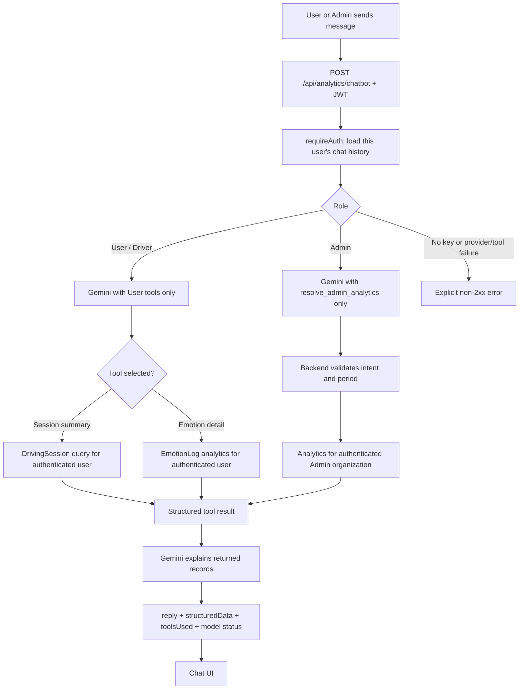

# FleetGuard AI Chatbot Flows

This guide describes the two Gemini-backed chat experiences: the User/Driver
assistant and the organization-scoped Admin assistant. It does not describe the
separate AI scanning/computer-vision pipeline.

## Runtime flow



## User / Driver

- The authenticated JWT is the source of the User ID. Model arguments cannot
  change the identity used for session or emotion queries.
- For driving-session summaries, Gemini can call
  `get_user_safety_summary`. The backend reads only that user's `DrivingSession`
  records and returns session count, average safety score, drowsy/yawn/
  distraction counts, alert counts, and duration.
- Session summaries and emotion statistics default to the latest 7 days.
  Explicit date bounds take precedence. A specified session ID selects that
  session even when it is older than 7 days.
- For detailed emotion telemetry, Gemini can call `query_emotion_stats`; the
  backend forces the authenticated User ID and defaults the time range to the
  latest 7 days when no range is supplied.
- General safety advice may be answered directly by Gemini; the assistant must
  not invent telemetry when no analytics tool was used.

## Admin

- Gemini receives only the `resolve_admin_analytics` tool. Its arguments are an
  allowed intent (`overview`, `alerts`, `emotions`, or `ranking`) and an
  optional period. Organization and driver IDs are never accepted from model
  arguments.
- The backend supplies the authenticated Admin's organization to analytics.
  Records are derived from that organization's users and their
  `DrivingSession` and `EmotionLog` records.
- The default period is 7 days. When it contains no usable records, analytics
  expands to 30 days and then all history for that organization. An explicit
  requested period is tried first.
- Gemini receives the structured result—including a structured no-data
  result—and writes the user-facing explanation. Numeric values come from
  backend analytics, not model invention.

## Gemini configuration and errors

Set these values in `backend/.env`:

```env
GEMINI_API_KEY=your_real_key
GEMINI_MODEL=gemini-3.6-flash
# Optional ordered failover list:
GEMINI_MODELS=gemini-3.6-flash,another-supported-model
# Optional request timeout in milliseconds:
GEMINI_TIMEOUT_MS=8000
```

Keep the API key on the backend. Do not add it to frontend environment
variables, chat requests, logs, or source control.

The backend tries configured models in order for retryable provider failures.
It calls the Gemini Interactions API on `v1beta` using the current
`@google/genai` SDK. The currently tested default is `gemini-3.6-flash`; this
default is appended after configured model IDs so a retired configured model
can fail over automatically.
If no API key is configured, it returns HTTP 503 with
`GEMINI_NOT_CONFIGURED`. If Gemini, its required tool call, or a backend tool
cannot complete, it returns a safe non-2xx error; it does not return an
internal-only narrative as if Gemini answered successfully. Internal
analytics can use the configured database or the backend's in-memory data
store, but that does not replace a required Gemini response.

Successful responses include `reply`, `structuredData`, `toolsUsed`,
`modelStatus`, and a timestamp; they also include the selected `model`.
Provider errors never expose credentials or raw provider messages to the UI.

## Data and model boundary

`DrivingSession` stores trip-level measures such as safety score, duration,
drowsiness/yawn/distraction counts, and peak alert level. `EmotionLog` stores
frame-level emotion and attention telemetry.

Gemini interprets questions, selects approved tools, and explains structured
results. It does not perform face recognition or train the computer-vision
model. Emotion labels are model signals, not definitive psychological facts.

The backend flow starts at `backend/src/controllers/analyticsController.js`,
shares Gemini orchestration in `ai-chatbot/src/chatService.js`, and resolves
Admin metrics in `backend/src/services/adminAnalyticsService.js` and User
session metrics in `backend/src/services/userAnalyticsService.js`.
